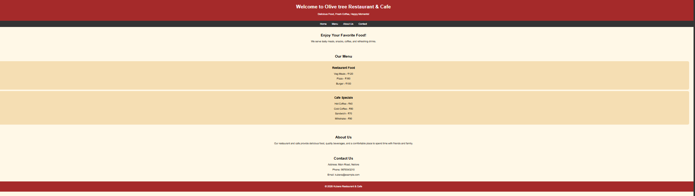
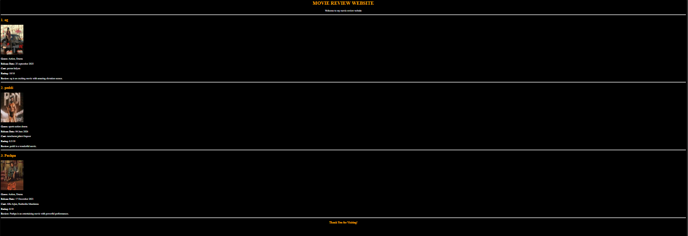

# web-development
Activity Based Learning

# WEB DEVELOPMENT LAB

**Student Name:** M.Satya Sai Rajesh

**Roll Number:**26001223

**Branch:** CSE (AI & ML)

**Year:** First Year B.Tech

**Section:** 06

**Subject:** Web Development

**Academic year:**2026-2030

---
### Case Study 1: Game Zone Website
**Description:** A simple gaming website featuring games and gaming-related information.

**Source Code:** [View web-abi.html](./web-abi.html)

**Output Screenshot:**

---
### Case Study 2: Restaurant Website
**Description:** A responsive restaurant website featuring menu, about us and contact information.

**Source Code:** [View web2.html](./web2.html)

**Output Screenshot:**

---
### Case Study 3: Movie Review and Rating Website
**Description:** A website displaying movie posters, genres, release dates, cast details, reviews, and ratings.

**Source Code:** [View web3.html](./web3.html)

**Output Screenshot:**

